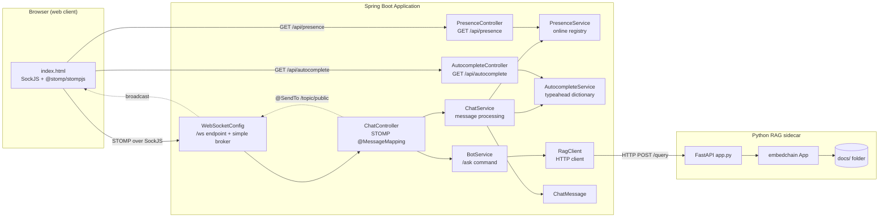
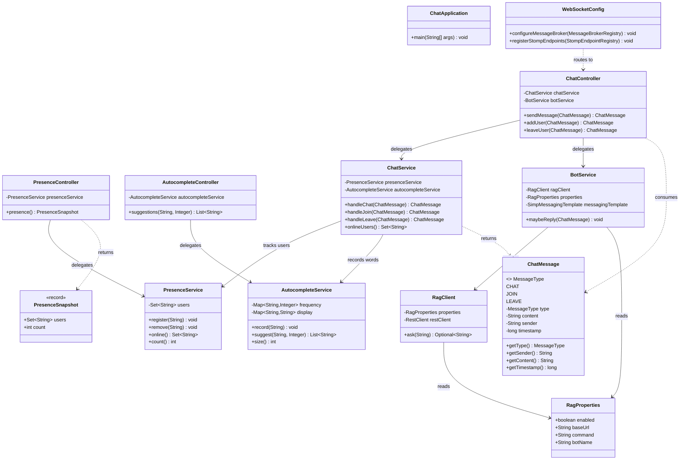
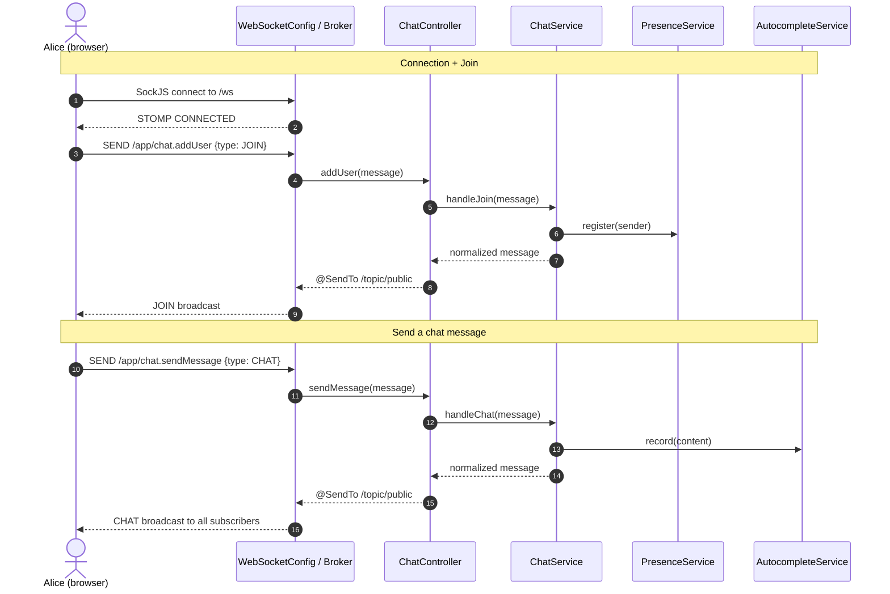
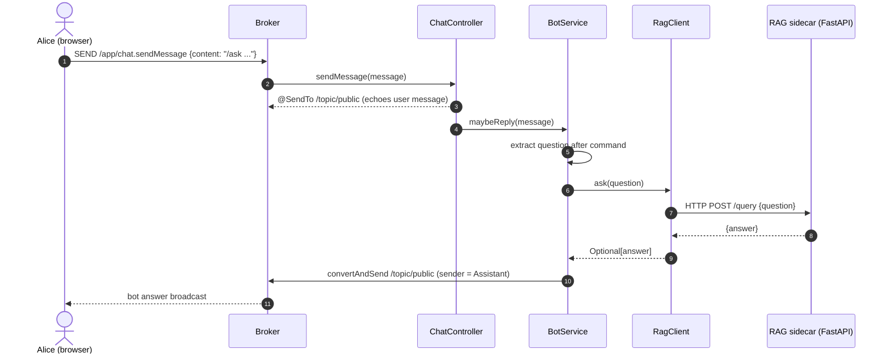
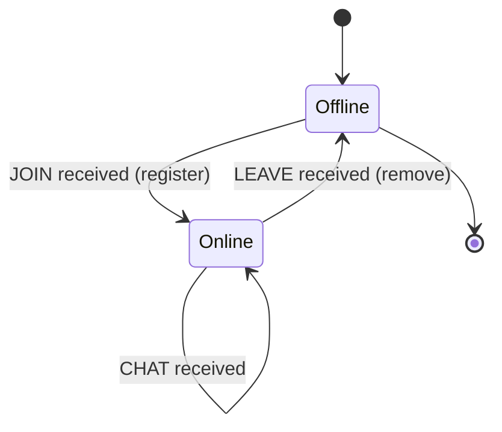
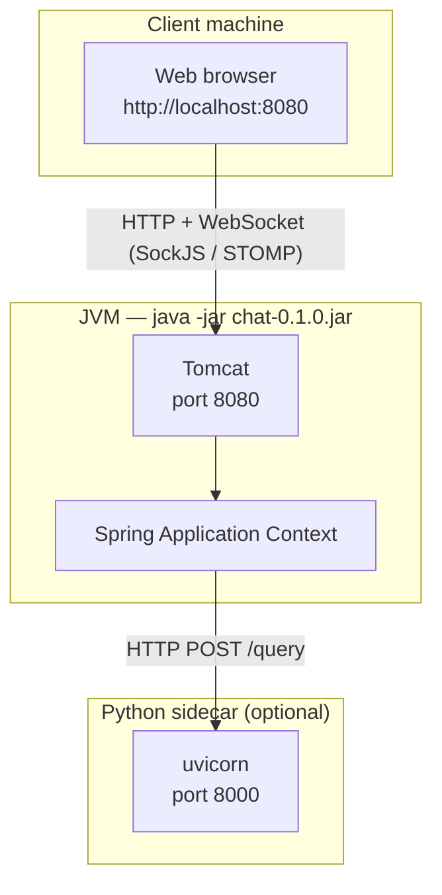

# UML Diagrams

Architecture and interaction diagrams for Realtime Chat. All diagrams are
written in [Mermaid](https://mermaid.js.org/) and render directly on GitHub.

## 1. Component Diagram

## 2. Class Diagram

## 3. Sequence Diagram — Join and Send a Message

## 4. Sequence Diagram — `/ask` Bot Answer

## 5. State Diagram — Presence Lifecycle

## 6. Deployment Diagram

## Regenerating

These diagrams are source-of-truth Mermaid text. To view them locally, open
this file in any Mermaid-aware editor (VS Code with the Mermaid extension,
GitHub, or <https://mermaid.live>). Update the diagrams whenever the
architecture no longer matches the code.
